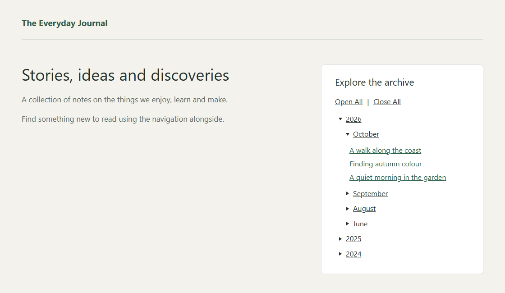
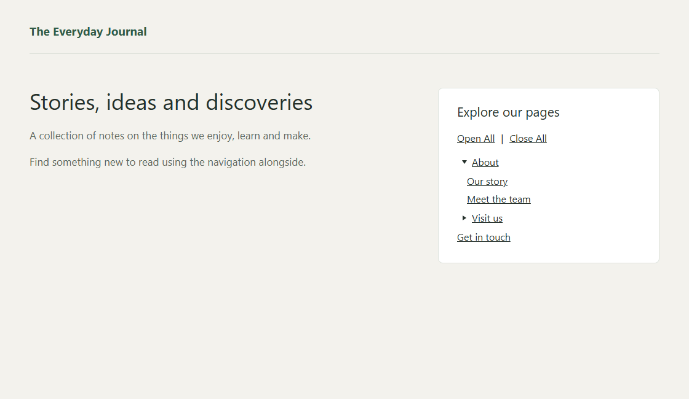
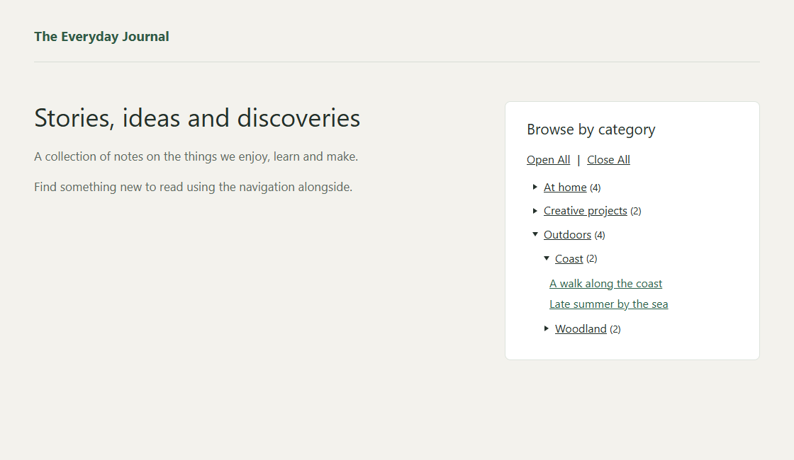
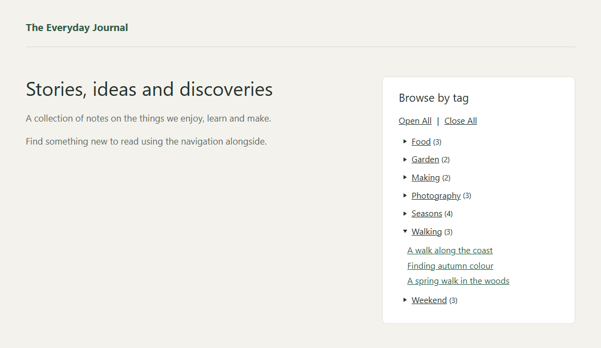

# Content Trees

- **Contributors:** ulfben
- **Tags:** archives, pages, navigation, widget, block
- **Requires at least:** 6.3
- **Tested up to:** 7.1
- **Requires PHP:** 7.4
- **Stable tag:** 0.10.0
- **License:** GPL-2.0-or-later
- **License URI:** https://www.gnu.org/licenses/gpl-2.0.html

Collapsible navigation for your archives, pages, categories and tags.

## Description

Help visitors find their way around your site with compact, collapsible trees for archives, pages, categories and tags. Visitors can open the branches that interest them without navigating away from the page.

Choose what to show, how to sort it, and which parts of your content to leave out. Highlight the current item and open its branches automatically to help visitors see where they are.

Content Trees is the modern successor to WP-dTree, bringing its familiar tree navigation to today’s WordPress sites.

### Features

* **Archives:** Browse posts by year and month, or show a simple list of months. Choose the order, show or hide posts and counts, and optionally link to archive pages.
* **Pages:** Show your page hierarchy, choose a starting page, exclude branches, and sort pages by title, menu order, publication date or last update.
* **Categories:** Show your category hierarchy, choose a starting category, and exclude categories and their children.
* **Tags:** Show tags and let visitors browse the posts assigned to each one.
* **Make each tree your own:** Show or hide posts, counts and empty categories or tags. Choose how categories, tags and posts are sorted, and exclude individual posts.
* **Easy to navigate:** Highlight the current post, page, category or tag and optionally open its branches. Offer Open All and Close All controls, or automatically close other branches at the same level.
* **Loads posts on demand:** Post titles load as visitors open archive, category and tag branches. Each branch offers its full list, with no pagination or arbitrary limits.
* **Works with your site:** Add trees using blocks with live previews, classic widgets or shortcodes.
* **Accessible controls:** Navigate trees with a keyboard, touch or a screen reader.

**Planned:** Custom taxonomies, custom post types and category-filtered archives are possibilities for future versions. Let us know which would be useful to you.

## Installation

1. Upload the plugin folder to `wp-content/plugins/`, or install the ZIP through Plugins > Add New > Upload Plugin.
2. Activate Content Trees.
3. Add a Content Trees block (Archive, Pages, Categories or Tags) in Appearance > Widgets. With a block theme, add one to a template or template part in Appearance > Editor.
4. Choose a title and display options, then save. You can also use the matching classic widget or a shortcode.

## Frequently Asked Questions

### How does Content Trees improve on WP-dTree?

Content Trees replaces the old dTree library with lightweight navigation built on native browser features and WordPress APIs. It adds blocks with live previews, keyboard and screen-reader support, and on-demand post loading to keep the initial display lighter.

### Can I use this alongside WP-dTree?

Yes. Content Trees installs separately and leaves WP-dTree's widgets and settings intact. Add a new tree to try it; existing widgets are not converted automatically.

### Can I add a tree with a shortcode?

Yes. Use `[content_trees_archive]`, `[content_trees_pages]`, `[content_trees_categories]` or `[content_trees_tags]`. Blocks and classic widgets offer the easiest way to choose display options.

### How are post counts calculated?

Category totals count each post once, including posts in visible child categories; tag totals count posts assigned to that tag. Excluded posts are left out of the tree and its counts, but linked archive pages keep their usual contents.

## Screenshots

**Archive tree** — Browse an archive by year and month, with posts revealed in an expanded month.

**Page tree** — Explore a hierarchy of pages with a branch expanded.

**Category tree** — Browse categories and open a category to see its posts.

**Tag tree** — Open a tag to see the posts associated with it.

## Changelog

### 0.10.0

* Make repeated page loads faster on large sites with category and tag trees.

### 0.9.10

* Restore loading announcements and alphabetical sort labels, including their translations.
* Refresh editor scripts correctly when the plugin is updated.

### 0.9.9

* Make Archive headings behave consistently across blocks, widgets and shortcodes.
* Keep branch controls and post loading consistent across tree types.

### 0.9.8

* Open category and tag branches to load their posts, while keeping the full category tree available immediately.
* Use less server memory when displaying categories and tags.

### 0.9.7

* Reduce background processing while configuring tree widgets.
* Keep selected page, post, category and tag names visible when changing block settings.

### 0.9.6

* Show the default Pages heading and Category/Tag editor settings in your site's language.
* Keep archive navigation usable without JavaScript when archive links are hidden.
* Reduce unnecessary processing when pages or other non-post content are edited.

### 0.9.5

* Show default Category and Tag headings in your site's language while keeping custom and intentionally blank titles.

### 0.9.4

* Add Category and Tag trees with blocks, classic widgets and shortcodes.
* Choose a category root, exclude terms or posts, and configure ordering, counts, empty terms and branch controls.
* Reduce server work when individual posts are hidden.

### 0.8.1

* Sort page trees by Published date or Last updated, with Oldest first / Newest first ordering.

### 0.8.0

* Add page trees as a block with live preview, a classic widget and shortcode.
* Choose a starting page, sort by title or menu order, and exclude pages together with their children.
* Highlight the current page and open its branch automatically, with optional Open All / Close All and sibling closing.

### 0.7

* Introduce the archive tree with complete-month loading, current-post highlighting and configurable year/month navigation.
* Add a block with live preview, a classic widget and shortcode support.
* Include post counts, ordering, searchable exclusions, Open All / Close All and optional closing of branches at the same level.
* Browse archives with keyboard, touch and screen-reader support.
